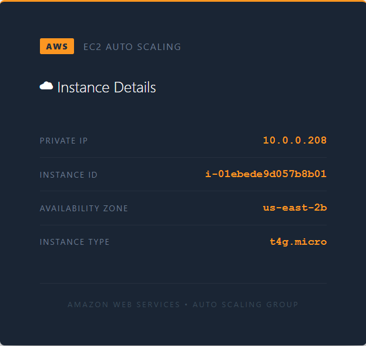

# AWS Auto Scaling: an Apache Fleet Behind an Application Load Balancer

A minimal **Auto Scaling group** of Apache web servers behind an
**Application Load Balancer**, built with Terraform in one phase. Each
instance serves a page showing its own private IP, instance ID,
availability zone and instance type, so you can watch the load balancer move
between them. CPU alarms scale the group between 1 and 6 instances. There's
no Packer image and no application code.



| Piece | Where | Role |
|---|---|---|
| **asg-&lt;suffix&gt;-vpc** | `10.0.0.0/24`, us-east-2 | public subnets `10.0.0.0/26` (2a) and `10.0.0.64/26` (2b), private subnets `10.0.0.128/26` (2a) and `10.0.0.192/26` (2b); internet gateway and a NAT gateway |
| **asg-&lt;suffix&gt;-alb** | public subnets | internet-facing ALB, HTTP 80; target group `asg-<suffix>-tg` with health checks on `/` |
| **asg-&lt;suffix&gt;-main** | private subnets | Auto Scaling group, min 1, desired 4, max 6, 180 s health check grace period |
| **Launch template** | | Ubuntu 24.04 ARM64, `t4g.micro` (Graviton2); user data installs Apache and writes the metadata page (via IMDSv2) and a plain-text `/plain` page with the IP |
| **Alarms + policies** | CloudWatch | `cpu-high` adds an instance, `cpu-low` removes one; both with a 120 s cooldown |
| **asg-&lt;suffix&gt;-ssm-role** | IAM | instance profile with `AmazonSSMManagedInstanceCore`, for Session Manager access |

The instances have no public IPs. The ALB accepts port 80 from the internet;
the instances accept port 80 only from the ALB's security group.

## Architecture

<picture>
  <source media="(prefers-color-scheme: dark)" srcset="architecture-dark.svg">
  
</picture>

Regenerate with `python3 make_diagram.py`.

**`01-autoscaling/`** is the whole stack: `networking.tf`, `security.tf`,
`alb.tf`, `lt.tf` (with `scripts/userdata.sh`), `asg.tf` (the group, the two
policies and the two alarms), `iam.tf`, and `outputs.tf`.

## Scaling policies

| Alarm | Condition | Periods | Action |
|---|---|---|---|
| `cpu-high` | average CPU above 60% | 2 × 1 minute | +1 instance |
| `cpu-low` | average CPU below 60% | 60 × 1 minute | -1 instance |

The hour-long scale-in window keeps instances from disappearing during a demo
or a short quiet spell.

## Prerequisites

* [An AWS Account](https://aws.amazon.com/console/)
* [Install AWS CLI](https://docs.aws.amazon.com/cli/latest/userguide/getting-started-install.html)
* [Install Terraform](https://developer.hashicorp.com/terraform/install)

If this is your first time watching our content, we recommend starting with
this video: [AWS + Terraform: Easy Setup](https://youtu.be/BCMQo0CB9wk).

## Deploy

```bash
git clone https://github.com/mamonaco1973/aws-autoscaling.git
cd aws-autoscaling
./apply.sh
```

`apply.sh` applies `01-autoscaling` and runs `validate.sh`, which waits for
healthy targets and the first HTTP 200, then samples six responses from
`/plain`; different IPs show the load balancer spreading requests:

```
NOTE: ALB endpoint: http://asg-alb-xxxxxxxxxx.us-east-2.elb.amazonaws.com
NOTE: Waiting for healthy targets in asg-tg...
NOTE: 4 healthy target(s) registered.
NOTE: Sampling ALB responses...

  [1] 10.0.0.221
  [2] 10.0.0.134
  [3] 10.0.0.221
  [4] 10.0.0.134
  [5] 10.0.0.221
  [6] 10.0.0.134

=================================================================================
  Auto Scaling Group — Deployment validated!
=================================================================================
  ALB : http://asg-alb-xxxxxxxxxx.us-east-2.elb.amazonaws.com
=================================================================================
```

## Try it

1. Open the **ALB** URL and refresh; the instance details change as
   requests land on different instances.
2. Generate CPU load on the instances (for example with Session Manager and
   `stress`) and watch `cpu-high` add instances, up to 6.

## Teardown

```bash
./destroy.sh
```

## Notes

- **Lab only.** The ALB serves plain HTTP.
